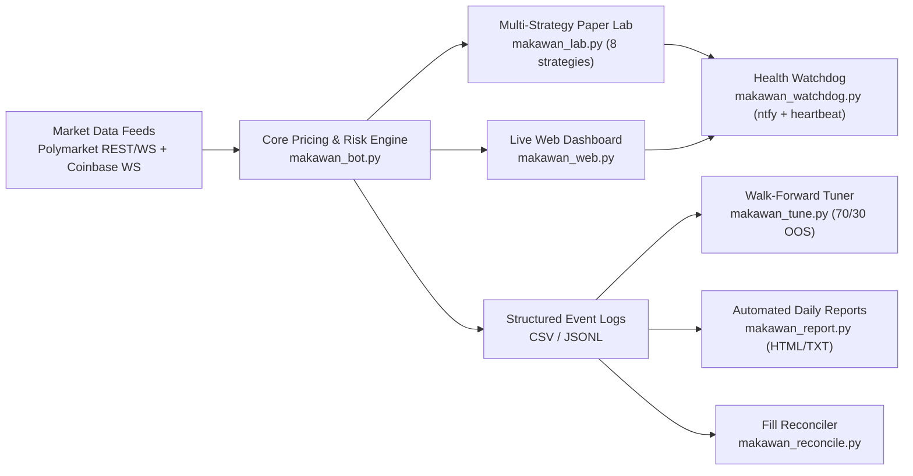

# Real-Time Market-Data Ingestion & Multi-Strategy Automation Lab

A modular **Python** real-time market-data ingestion, statistical modeling, multi-strategy experimentation, and autonomous operations platform built for Polymarket US BTC prediction windows (`5m` / `15m` / `1h`).

> **Safety & Offline Demo:** Every paper engine, multi-strategy lab, simulator, backtester, and test suite runs **read-only with zero API keys**. Live order execution lives in an isolated module (`makawan_live.py`) guarded by explicit rehearsal mode, hard stop-loss circuit breakers, and interactive confirmation.

---

## Architecture Overview



## Key Engineering Highlights

* **Real-Time Dual-Feed Ingestion & Failover:** Streams order books over Polymarket WebSockets (`--stream`) and BTC spot prices over Coinbase WebSockets (`--spot`), with staleness guards, 15-second cross-feed discrepancy verification, and automatic REST polling failover.
* **Parallel Multi-Strategy Experimentation Lab (`makawan_lab.py`):** Evaluates up to 8 strategies side-by-side (`baseline`, `cut`, `cautious`, `trend`, `fade`, `maker`, `sniper`, `terry`) against one shared live data stream with realistic delayed fill simulation, fee modeling, and a live leaderboard web UI.
* **Walk-Forward Statistical Backtesting (`makawan_tune.py` & `late_backtest.py`):** Downloads public BRTI index history, splits 70/30 train/out-of-sample, calibrates volatility/tail/blend parameters, and gates proposals on statistical significance (`>2 SE` improvement)—proposing changes without auto-applying.
* **Autonomous Operations & Risk Guardrails:**
  * **Risk Guard:** Worst-case stop-loss and daily loss circuit breakers persisted in `state.json` across restarts.
  * **Watchdog (`makawan_watchdog.py`):** Monitors process liveness, feed freshness, system sleep gaps, and stop-loss proximity; dispatches `ntfy` push alerts and dead-man's-switch heartbeats.
  * **Daily Reporting (`makawan_report.py`):** Automated HTML/text P&L breakdowns, anomaly detection, and statistical luck checks.
  * **Reconciler (`makawan_reconcile.py`):** Compares internal execution logs against exchange fills to surface slippage, missed fills, or unknown fills.
* **Automated Verification (`test_makawan.py`):** **141 unit & integration tests** covering probability math, order-book walking, fee/slippage modeling, risk halts, mock exchange execution, watchdog alerts, and strategy lab mechanics.

---

## Module Map

| Module | Purpose |
| :--- | :--- |
| `makawan_bot.py` | Core pricing/probability engine, order-book walker, WebSocket stream, risk guard, and terminal dashboard |
| `makawan_lab.py` | Parallel multi-strategy paper-trading lab with live leaderboard web server |
| `makawan_web.py` | Local real-time web dashboard with gauges, charts, scorecards, and CSV export |
| `makawan_tune.py` | Out-of-sample (70/30) walk-forward backtester and parameter proposal generator |
| `makawan_report.py` | Automated daily P&L, calibration, and anomaly report generator (`.html` / `.txt`) |
| `makawan_watchdog.py` | Health monitoring daemon with push notifications (`ntfy`) and heartbeat pings |
| `makawan_reconcile.py` | Read-only exchange fill & balance reconciler (slippage / discrepancy audit) |
| `makawan_live.py` | Isolated live-order runner with `--rehearse` dry-run mode and strict halt conditions |
| `simulate_week.py` | Multi-day synthetic market simulator (including efficient-market control) |
| `lab_replay.py` / `late_backtest.py` | Offline replay & late-entry band backtesting over recorded session logs |
| `makawan_latency_check.py` / `makawan_connect_check.py` / `makawan_fills.py` | Read-only latency benchmarking, credential verification, and fill-quality diagnostics |
| `test_makawan.py` | 141-test `pytest` suite |

---

## Quickstart (Offline Simulation & Tests — Zero API Keys)

```bash
pip install -r requirements.txt

# 1. Run full automated test suite (141 tests)
pytest -q test_makawan.py

# 2. Launch live web dashboard in offline 30x simulated mode
python makawan_web.py --simulate --open

# 3. Launch multi-strategy lab in offline simulated mode
python makawan_lab.py --simulate --open

# 4. Run core mathematical self-test
python makawan_bot.py --selftest
```

For full CLI flags, strategy rules, fee calibration notes, and live operational procedures, see [DOCS.md](./DOCS.md).

---

*Disclaimer: Built for market-data engineering, statistical modeling, and automated systems experimentation. Not financial advice.*
